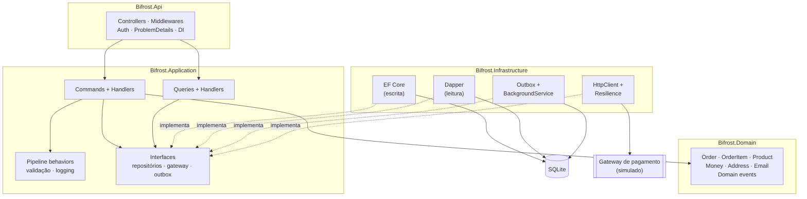
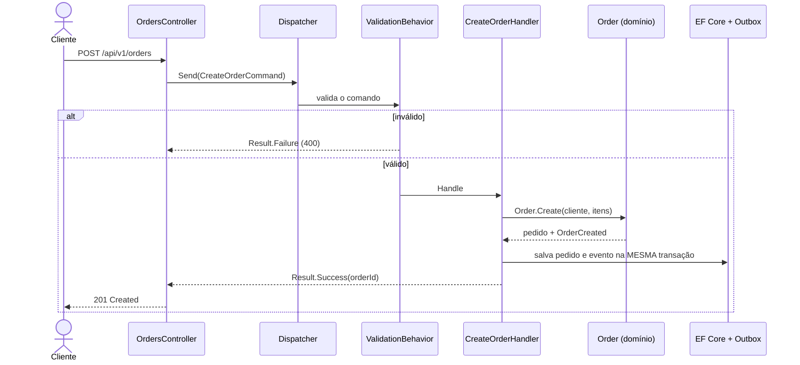
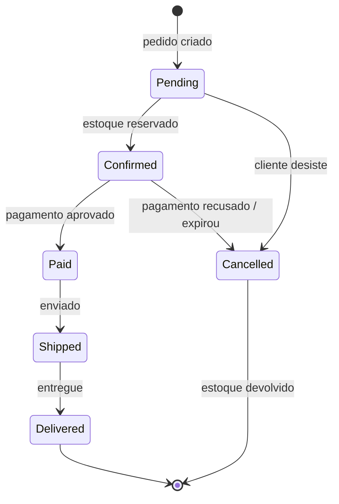
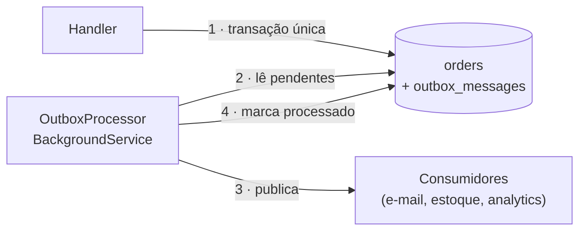

<div align="center">


# ✦ Bifrost
### A ponte arco-íris que leva cada pedido ao destino

**API de pedidos de e-commerce com ASP.NET Core (.NET 10), Clean Architecture e CQRS.**
Do carrinho à entrega: regras de pedido no domínio, escrita com EF Core e leitura com Dapper,<br/>
eventos confiáveis com Outbox, integrações resilientes e observabilidade com OpenTelemetry.

[](https://github.com/GustavoThe01/bifrost-orders/actions/workflows/ci.yml)


</div>

---

## 👨‍💻 Autor

<table>
  <tr>
    <td width="62%">

**Bifrost** é o quinto e maior projeto do meu portfólio público de Desenvolvedor Pleno, idealizado e mantido por **Gustavo Osterno Thé**.

Ele reúne tudo o que os projetos anteriores construíram: o modelo de dados do [Mercurium](https://github.com/GustavoThe01/mercurium-sql), a modelagem de domínio do [Plutus](https://github.com/GustavoThe01/plutus-ledger) e os padrões de produção da [Moirai](https://github.com/GustavoThe01/moirai-taskflow), agora numa API .NET completa, com os problemas reais de um e-commerce: estoque disputado, pagamentos que falham e eventos que não podem se perder.

    </td>
    <td width="38%">

| | |
|---|---|
| 🌐 Site | [site-gustavothe-dev.web.app](https://site-gustavothe-dev.web.app/) |
| 💼 LinkedIn | [gustavoosterno](https://www.linkedin.com/in/gustavoosterno/) |
| 🐙 GitHub | [@GustavoThe01](https://github.com/GustavoThe01) |
| 📸 Instagram | [@gustavo.osterno](https://www.instagram.com/gustavo.osterno) |

    </td>
  </tr>
</table>

---

## 📑 Sumário

- [Em números](#-em-números)
- [A origem do nome](#-a-origem-do-nome)
- [O que a API faz](#-o-que-a-api-faz)
- [Endpoints planejados](#-endpoints-planejados)
- [Clean Architecture](#️-clean-architecture)
- [CQRS: escrita e leitura separadas](#-cqrs-escrita-e-leitura-separadas)
- [O ciclo de vida de um pedido](#-o-ciclo-de-vida-de-um-pedido)
- [Eventos confiáveis com Outbox](#-eventos-confiáveis-com-outbox)
- [Competências demonstradas](#-competências-demonstradas)
- [Metodologias e decisões](#-metodologias-e-decisões)
- [Roadmap](#️-roadmap)
- [Como rodar](#-como-rodar)
- [Testes](#-testes)
- [Estrutura do projeto](#-estrutura-do-projeto)
- [O que ainda falta](#-o-que-ainda-falta)
- [Projetos relacionados](#-projetos-relacionados)

---

## 📊 Em números

<div align="center">

| 🌐 API | 🏛️ Arquitetura | 🛡️ Produção | 🗓️ Processo |
|:---:|:---:|:---:|:---:|
| **~18** endpoints planejados | **4** camadas (Clean Architecture) | JWT + políticas | **20** dias / **4** semanas |
| ProblemDetails + Result pattern | CQRS com dispatcher **próprio** | Outbox · retry · circuit breaker | **2** ADRs registrados |
| versionamento `v1` / `v2` | EF Core (escrita) + Dapper (leitura) | OpenTelemetry · Serilog · health checks | **4** releases (`v0.1` → `v1.0`) |

</div>

---

## ✦ A origem do nome

> *Na mitologia nórdica, Bifrost é a ponte arco-íris que liga Midgard, o mundo dos homens, a Asgard, o reino dos deuses. Heimdall a vigia dia e noite.*

Um pedido também atravessa mundos: sai do **carrinho do cliente**, passa pelo **estoque**, pelo **gateway de pagamento** e pela **transportadora**, até chegar à **entrega**. A Bifrost é essa ponte, e como Heimdall, ela vigia cada travessia: nenhum pedido avança sem estoque reservado e pagamento confirmado, e nenhum evento se perde no caminho.

---

## ✨ O que a API faz

| Módulo | O que resolve |
|---|---|
| 🛍️ **Catálogo** | Produtos com preço, estoque e cache de leitura |
| 👤 **Clientes** | Cadastro, endereços e autenticação (`Customer` / `Admin`) |
| 🧾 **Pedidos** | Criação, itens, cálculo de total e **máquina de estados** |
| 📦 **Estoque** | Reserva ao confirmar pedido, com **concorrência otimista** contra venda dupla |
| 💳 **Pagamentos** | Gateway externo simulado, com retry, timeout e circuit breaker |
| 📣 **Eventos** | Domain events gravados no **Outbox** e publicados por um `BackgroundService` |
| 📈 **Operação** | Health checks, logs estruturados, traces e métricas |

---

## 🌐 Endpoints planejados

| Método | Rota | Descrição | Dia |
|---|---|---|:---:|
| `GET` | `/health` | Saúde da aplicação | ✅ 01 |
| `GET` | `/health/ready` · `/health/live` | Prontidão e vitalidade (Docker/Kubernetes) | 15 |
| `POST` | `/api/v1/auth/token` | Emite token JWT | 11 |
| `GET` | `/api/v1/products` | Catálogo paginado (com cache) | 05 · 16 |
| `POST` | `/api/v1/products` | Cadastra produto (`Admin`) | 05 |
| `POST` | `/api/v1/orders` | Cria pedido | 05 |
| `GET` | `/api/v1/orders` | Lista pedidos do cliente (Dapper) | 06 |
| `GET` | `/api/v1/orders/{id}` | Detalhe do pedido | 06 |
| `POST` | `/api/v1/orders/{id}/confirm` | Confirma e reserva estoque | 09 |
| `POST` | `/api/v1/orders/{id}/pay` | Paga via gateway externo | 14 |
| `POST` | `/api/v1/orders/{id}/cancel` | Cancela (devolve estoque) | 07 |
| `GET` | `/api/v2/orders/{id}` | Nova versão do detalhe do pedido | 17 |

Exemplo de erro de negócio (**ProblemDetails**, mapeado a partir do Result pattern):

```json
{
  "type": "https://bifrost.dev/errors/insufficient-stock",
  "title": "Estoque insuficiente",
  "status": 409,
  "detail": "O produto SKU-0042 tem 1 unidade disponível e o pedido pede 3.",
  "traceId": "00-4bf92f3577b34da6a3ce929d0e0e4736-00f067aa0ba902b7-01"
}
```

---

## 🏛️ Clean Architecture

As dependências apontam sempre para o centro. O domínio não conhece EF Core, HTTP nem o gateway de pagamento. Decisão no [ADR 0001](docs/adr/0001-clean-architecture.md).



> ✅ A regra "**Domain não depende de ninguém**" já é verificada por teste ([`LayerDependencyTests`](tests/Bifrost.Domain.Tests/LayerDependencyTests.cs)). No Dia 19 ela ganha o reforço do NetArchTest.

---

## ⚡ CQRS: escrita e leitura separadas

| | Commands (escrita) | Queries (leitura) |
|---|---|---|
| **Objetivo** | Mudar estado com regras de negócio | Responder rápido, sem efeitos colaterais |
| **Passa pelo domínio?** | Sim, sempre pelo agregado | Não, projeta direto para DTO |
| **Tecnologia** | EF Core + change tracking + transação | Dapper com SQL otimizado |
| **Pipeline** | Validação (FluentValidation) + logging + transação | Logging |

O despacho é feito por um **dispatcher próprio** com decorators, em vez do MediatR (que passou a ter licença comercial). Veja o [ADR 0002](docs/adr/0002-dispatcher-proprio.md).



---

## 🔄 O ciclo de vida de um pedido



---

## 📣 Eventos confiáveis com Outbox

**O problema:** salvar o pedido e publicar o evento "pedido criado" são duas operações. Se o banco grava e a publicação falha, o resto do sistema nunca fica sabendo.

**A solução (Outbox pattern):** o evento é gravado numa tabela `outbox_messages` **na mesma transação** do pedido. Um `BackgroundService` lê essa tabela e publica, marcando como processado.



---

## 🧠 Competências demonstradas

| Área | Conceitos |
|---|---|
| **Arquitetura** | Clean Architecture, CQRS, separação escrita × leitura, regra de dependência testada |
| **Domínio** | Agregados, value objects (owned types), máquina de estados, domain events |
| **Padrões** | Dispatcher + Decorator (pipeline behaviors), Result pattern, Outbox, Repository |
| **EF Core** | Fluent API, `IEntityTypeConfiguration`, migrations, `AsNoTracking`, token de concorrência |
| **API** | Controllers, ProblemDetails, `IExceptionHandler`, OpenAPI, `Asp.Versioning` |
| **Segurança** | JWT, roles, **políticas de autorização** (cliente só vê o próprio pedido) |
| **Resiliência** | `HttpClientFactory`, Microsoft.Extensions.Http.Resilience (retry, timeout, circuit breaker) |
| **Performance** | HybridCache, Output Cache, rate limiting nativo, teste de carga com k6 |
| **Observabilidade** | Serilog, correlation id, OpenTelemetry (traces + métricas), .NET Aspire dashboard |
| **Testes** | xUnit v3, NSubstitute, `WebApplicationFactory`, NetArchTest |
| **DevOps** | `.slnx`, Central Package Management, Docker, health checks, GitHub Actions |

---

## 🧭 Metodologias e decisões

- **Domínio primeiro**, testado antes de qualquer endpoint existir.
- **Roadmap diário público** com uma release por semana. Veja o [ROADMAP.md](ROADMAP.md).
- **Conventional Commits**, versionamento semântico e **ADRs**.
- **Warnings são erros**, versões de pacotes centralizadas.

| ADR | Decisão | Status |
|---|---|---|
| [0001](docs/adr/0001-clean-architecture.md) | Clean Architecture em 4 projetos | ✅ Aceita |
| [0002](docs/adr/0002-dispatcher-proprio.md) | Dispatcher próprio de commands/queries em vez de MediatR | ✅ Aceita |
| 0003 | Leituras críticas com Dapper (CQRS de verdade) | ⏳ Dia 06 |

---

## 🗺️ Roadmap

| Semana | Dias | Tema | Release | Progresso |
|---|---|---|:---:|---|
| 1 | 01–05 | Solution, domínio, EF Core, CQRS, API | `v0.1.0` | 🟦⬜⬜⬜⬜ |
| 2 | 06–10 | Leitura com Dapper, Result pattern, testes, concorrência, logging | `v0.2.0` | ⬜⬜⬜⬜⬜ |
| 3 | 11–15 | JWT, políticas, Outbox, resiliência, Docker | `v0.3.0` | ⬜⬜⬜⬜⬜ |
| 4 | 16–20 | Cache, versionamento, OpenTelemetry, qualidade e entrega | `v1.0.0` | ⬜⬜⬜⬜⬜ |

Detalhes no [ROADMAP.md](ROADMAP.md) · Mudanças no [CHANGELOG.md](CHANGELOG.md).

---

## 🚀 Como rodar

**Pré-requisito:** [.NET 10 SDK](https://dotnet.microsoft.com/download).

```bash
git clone https://github.com/GustavoThe01/bifrost-orders.git
```

```bash
cd bifrost-orders
```

Subir a API:

```bash
dotnet run --project src/Bifrost.Api --launch-profile http
```

Verificar se está no ar:

```bash
curl http://localhost:5080/health
```

Resposta esperada: `Healthy`

> 🐳 A partir do Dia 15: `docker compose up`.
> 📘 A partir do Dia 05: documentação interativa da API (OpenAPI + Scalar).

---

## 🧪 Testes

Os testes usam **xUnit v3** sobre o **Microsoft.Testing.Platform**, o novo executor do .NET 10 (configurado em [`global.json`](global.json)).

```bash
dotnet test
```

| Projeto de teste | Tipo | Situação |
|---|---|---|
| `Bifrost.Domain.Tests` | Unitários + regra de camadas | 🟡 1 teste (dependência entre camadas) |
| `Bifrost.Application.Tests` | Handlers com NSubstitute | ⏳ Dia 08 |
| `Bifrost.IntegrationTests` | `WebApplicationFactory` + SQLite em memória | ⏳ Dia 08 |
| `Bifrost.ArchitectureTests` | NetArchTest | ⏳ Dia 19 |
| Carga | k6 no endpoint de criação de pedido | ⏳ Dia 19 |

---

## 📁 Estrutura do projeto

```
bifrost-orders/
├── .github/workflows/ci.yml          # ✅ restore, build e testes a cada push
├── docs/
│   ├── adr/                          # ✅ decisões de arquitetura
│   └── assets/                       # ✅ banner e imagens
├── src/
│   ├── Bifrost.Domain/               # ✅ projeto · ⏳ Dia 02 — Order, value objects
│   ├── Bifrost.Application/          # ✅ projeto · ⏳ Dia 04 — CQRS
│   ├── Bifrost.Infrastructure/       # ✅ projeto · ⏳ Dia 03 — EF Core
│   └── Bifrost.Api/                  # ✅ /health · ⏳ Dia 05 — controllers
├── tests/
│   └── Bifrost.Domain.Tests/         # ✅ teste de arquitetura
├── Bifrost.slnx
├── Directory.Build.props             # ✅ Nullable, warnings como erro
├── Directory.Packages.props          # ✅ versões centralizadas
├── global.json                       # ✅ SDK + Microsoft.Testing.Platform
├── .editorconfig
├── CHANGELOG.md
└── ROADMAP.md
```

---

## 🧩 O que ainda falta

Checklist vivo do que ainda precisa ser incrementado neste repositório.

**Projeto**
- [ ] Agregado `Order`, value objects e máquina de estados (Dia 02)
- [ ] EF Core + SQLite, configurações e primeira migration (Dia 03)
- [ ] Dispatcher CQRS e pipeline de validação (Dia 04)
- [ ] Controllers, ProblemDetails e OpenAPI (Dia 05) → `v0.1.0`
- [ ] Leitura com Dapper, Result pattern, testes, concorrência e Serilog (Dias 06–10) → `v0.2.0`
- [ ] JWT, políticas, Outbox, resiliência e Docker (Dias 11–15) → `v0.3.0`
- [ ] Cache, versionamento, OpenTelemetry, NetArchTest, k6 e entrega (Dias 16–20) → `v1.0.0`

**README**
- [ ] Prints da documentação da API (Scalar) e do dashboard do .NET Aspire
- [ ] Diagrama C4 (contexto e containers)
- [ ] Resultado do teste de carga (k6) com números reais
- [ ] Badges de cobertura e de qualidade
- [ ] Link do deploy, se publicado (Azure / Fly.io)
- [ ] Atualizar "Em números", endpoints e testes com valores reais
- [ ] Definir e adicionar uma licença (`LICENSE`)
- [ ] Versão em inglês do README

---

## 🔗 Projetos relacionados

| Projeto | Stack | Relação |
|---|---|---|
| ☿ [Mercurium](https://github.com/GustavoThe01/mercurium-sql) | SQLite | **Modelo de dados de e-commerce reaproveitado aqui** |
| ⚒ [Nidavellir](https://github.com/GustavoThe01/nidavellir-inventory) | Java 21 | Fundamentos de POO e estoque |
| ⚖ [Plutus](https://github.com/GustavoThe01/plutus-ledger) | C# + Dapper | **Base em .NET**: DDD e transações explícitas |
| ♾ [Moirai](https://github.com/GustavoThe01/moirai-taskflow) | Spring Boot | A mesma maturidade de produção, em Java |
| ✦ **Bifrost** | ASP.NET Core | *você está aqui* |

<div align="center">

<sub>Ponte construída por <a href="https://github.com/GustavoThe01">Gustavo Osterno Thé</a></sub>

</div>
