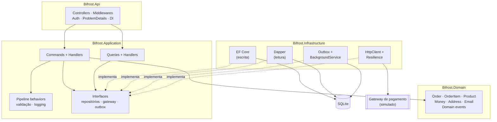
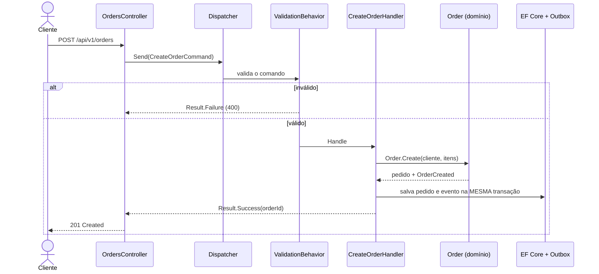
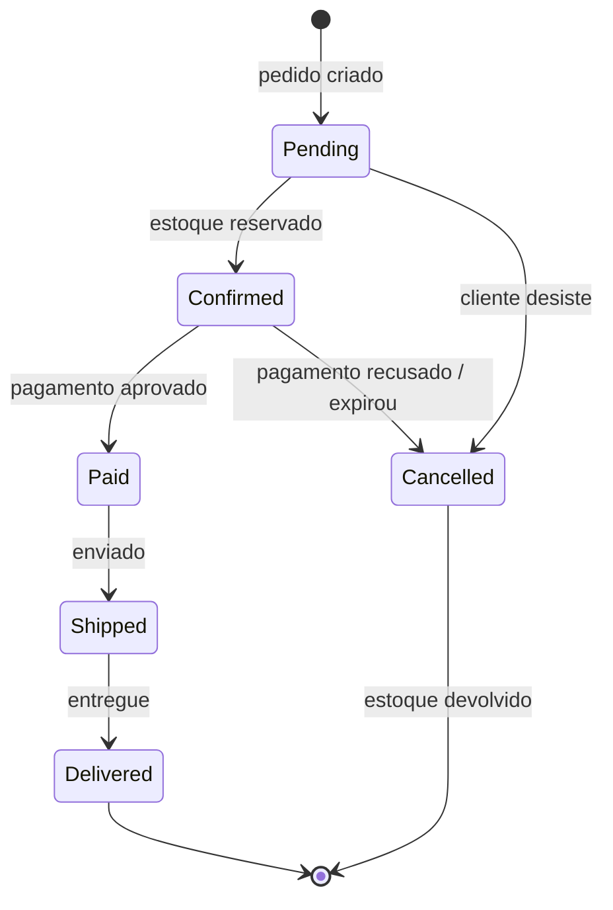
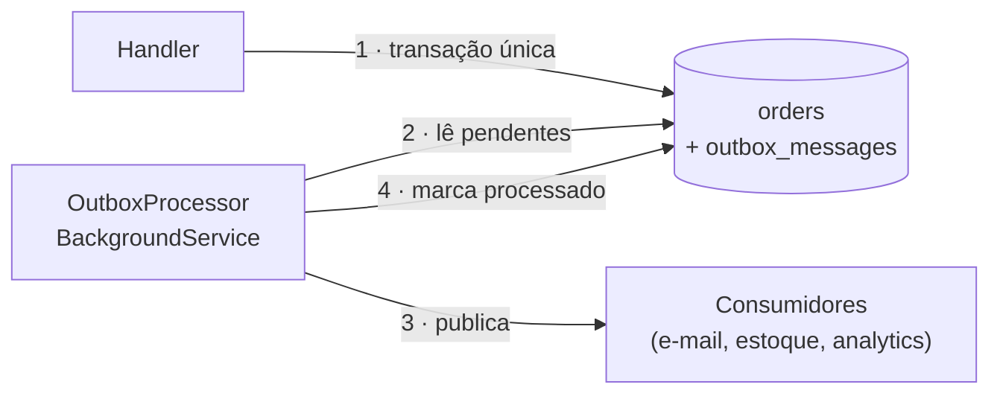

<div align="center">


# ✦ Bifrost
### A ponte arco-íris que leva cada pedido ao destino

**API de pedidos de e-commerce com ASP.NET Core (.NET 10), Clean Architecture e CQRS.**
Do carrinho à entrega: regras de pedido no domínio, escrita com EF Core e leitura com Dapper,<br/>
eventos confiáveis com Outbox, integrações resilientes e observabilidade com OpenTelemetry.

[](https://github.com/GustavoThe01/bifrost-orders/actions/workflows/ci.yml)


</div>

---

## 👨‍💻 Autor

<table>
  <tr>
    <td width="62%">

Eu sou o **Gustavo Osterno Thé**, e a **Bifrost** é o maior dos cinco projetos do meu portfólio público de Desenvolvedor Pleno. Idealizei, desenvolvo e mantenho este repositório.

Nela eu junto o que pratico nos outros projetos: o modelo de dados do [Mercurium](https://github.com/GustavoThe01/mercurium-sql), a modelagem de domínio do [Plutus](https://github.com/GustavoThe01/plutus-ledger) e os padrões de produção da [Moirai](https://github.com/GustavoThe01/moirai-taskflow), agora numa API .NET completa, com os problemas reais de um e-commerce: estoque disputado, pagamentos que falham e eventos que não podem se perder.

    </td>
    <td width="38%">

| | |
|---|---|
| 🌐 Site | [site-gustavothe-dev.web.app](https://site-gustavothe-dev.web.app/) |
| 💼 LinkedIn | [gustavoosterno](https://www.linkedin.com/in/gustavoosterno/) |
| 🐙 GitHub | [@GustavoThe01](https://github.com/GustavoThe01) |
| 📸 Instagram | [@gustavo.osterno](https://www.instagram.com/gustavo.osterno) |

    </td>
  </tr>
</table>

---

## 📑 Sumário

- [Em números](#-em-números)
- [A origem do nome](#-a-origem-do-nome)
- [O que a API faz](#-o-que-a-api-faz)
- [Endpoints planejados](#-endpoints-planejados)
- [Clean Architecture](#️-clean-architecture)
- [CQRS: escrita e leitura separadas](#-cqrs-escrita-e-leitura-separadas)
- [O ciclo de vida de um pedido](#-o-ciclo-de-vida-de-um-pedido)
- [Eventos confiáveis com Outbox](#-eventos-confiáveis-com-outbox)
- [Dez pedidos, uma unidade](#-dez-pedidos-uma-unidade)
- [Logs estruturados e correlation id](#-logs-estruturados-e-correlation-id)
- [Autenticação com JWT](#-autenticação-com-jwt)
- [Competências demonstradas](#-competências-demonstradas)
- [Metodologias e decisões](#-metodologias-e-decisões)
- [Roadmap](#️-roadmap)
- [Como rodar](#-como-rodar)
- [Testes](#-testes)
- [Estrutura do projeto](#-estrutura-do-projeto)
- [O que ainda falta](#-o-que-ainda-falta)
- [Projetos relacionados](#-projetos-relacionados)

---

## 📊 Em números

<div align="center">

| 🌐 API | 🏛️ Arquitetura | 🛡️ Produção | 🗓️ Processo |
|:---:|:---:|:---:|:---:|
| **12** endpoints planejados | **4** camadas (Clean Architecture) | JWT + políticas | **20** dias / **4** semanas |
| ProblemDetails + Result pattern | CQRS com dispatcher **próprio** | Outbox · retry · circuit breaker | **4** ADRs registrados |
| versionamento `v1` / `v2` | EF Core (escrita) + Dapper (leitura) | OpenTelemetry · Serilog · health checks | **4** releases (`v0.1` → `v1.0`) |

<sub>Metas para o fim do roadmap. O estado atual está nos badges, na seção <a href="#-testes">Testes</a> e em <a href="#-o-que-ainda-falta">O que ainda falta</a>.</sub>

</div>

---

## ✦ A origem do nome

> *Na mitologia nórdica, Bifrost é a ponte arco-íris que liga Midgard, o mundo dos homens, a Asgard, o reino dos deuses. Heimdall a vigia dia e noite.*

Escolhi o nome porque um pedido também atravessa mundos: sai do **carrinho do cliente**, passa pelo **estoque**, pelo **gateway de pagamento** e pela **transportadora**, até chegar à **entrega**. A Bifrost é essa ponte e, como Heimdall, vigia cada travessia: nenhum pedido avança sem estoque reservado e pagamento confirmado, e nenhum evento se perde no caminho.

---

## ✨ O que a API faz

| Módulo | O que resolve |
|---|---|
| 🛍️ **Catálogo** | Produtos com preço, estoque e cache de leitura |
| 👤 **Clientes** | Cadastro, endereços e autenticação (`Customer` / `Admin`) |
| 🧾 **Pedidos** | Criação, itens, cálculo de total e **máquina de estados** |
| 📦 **Estoque** | Reserva ao confirmar pedido, com **concorrência otimista** contra venda dupla |
| 💳 **Pagamentos** | Gateway externo simulado, com retry, timeout e circuit breaker |
| 📣 **Eventos** | Domain events gravados no **Outbox** e publicados por um `BackgroundService` |
| 📈 **Operação** | Health checks, logs estruturados, traces e métricas |

---

## 🌐 Endpoints planejados

| Método | Rota | Descrição | Dia |
|---|---|---|:---:|
| `GET` | `/health` | Saúde da aplicação | ✅ 01 |
| `GET` | `/health/ready` · `/health/live` | Prontidão e vitalidade (Docker/Kubernetes) | 15 |
| `POST` | `/api/v1/auth/token` | Emite token JWT (contas de demonstração) | ✅ 11 |
| `GET` | `/api/v1/products` | Catálogo, sem token (paginação no 06 e cache no 16) | ✅ 05 |
| `POST` | `/api/v1/products` | Cadastra produto, só perfil `Admin` | ✅ 05 · perfil no 11 |
| `POST` | `/api/v1/orders` | Cria pedido para o cliente dono do token, só perfil `Customer` | ✅ 05 · token no 11 |
| `GET` | `/api/v1/orders` | Lista pedidos com filtro por cliente e status, paginada (Dapper) | ✅ 06 |
| `GET` | `/api/v1/orders/{id}` | Detalhe do pedido | ✅ 05 |
| `POST` | `/api/v1/orders/{id}/confirm` | Confirma o pedido e reserva o estoque | ✅ 05 · reserva no 09 |
| `POST` | `/api/v1/orders/{id}/pay` | Paga via gateway externo | 14 |
| `POST` | `/api/v1/orders/{id}/cancel` | Cancela o pedido e devolve o estoque reservado | ✅ 05 · devolução no 09 |
| `GET` | `/api/v2/orders/{id}` | Nova versão do detalhe do pedido | 17 |

Os casos de uso devolvem `Result<T>`, e a API traduz a categoria do erro em status HTTP num lugar só
([ADR 0004](docs/adr/0004-result-pattern.md)):

| Categoria do erro | Status | Exemplo |
|---|:---:|---|
| `Validation` | 400 | quantidade fora de 1 a 99 |
| `NotFound` | 404 | pedido ou produto inexistente |
| `Conflict` | 409 | SKU já cadastrado |
| `BusinessRule` | 422 | confirmar um pedido cancelado |

Exemplo real, ao confirmar um pedido que já foi cancelado:

```json
{
  "type": "/problems/business-rule",
  "title": "Regra de negócio violada",
  "status": 422,
  "detail": "Não é possível confirmar um pedido em Cancelled. Esperado: Pending.",
  "instance": "/api/v1/orders/0199f5c2-6a1e-7b3c-9d4e-2f8a1b6c7d90/confirm",
  "code": "business_rule",
  "traceId": "00-4bf92f3577b34da6a3ce929d0e0e4736-00f067aa0ba902b7-01"
}
```

O campo `code` é estável (`order.not_found`, `product.sku_taken`): quem consome a API trata o erro por ele,
sem depender do texto da mensagem.

---

## 🏛️ Clean Architecture

As dependências apontam sempre para o centro. O domínio não conhece EF Core, HTTP nem o gateway de pagamento. Registrei essa decisão no [ADR 0001](docs/adr/0001-clean-architecture.md).



> ✅ A regra "**Domain não depende de ninguém**" já está protegida por um teste que escrevi no Dia 01 ([`LayerDependencyTests`](tests/Bifrost.Domain.Tests/LayerDependencyTests.cs)). No Dia 19 vou reforçá-la com o NetArchTest.

---

## ⚡ CQRS: escrita e leitura separadas

| | Commands (escrita) | Queries (leitura) |
|---|---|---|
| **Objetivo** | Mudar estado com regras de negócio | Responder rápido, sem efeitos colaterais |
| **Passa pelo domínio?** | Sim, sempre pelo agregado | Não, projeta direto para DTO |
| **Tecnologia** | EF Core + change tracking + transação | Dapper com SQL otimizado |
| **Pipeline** | Validação (FluentValidation) + logging + transação | Logging |

Optei por escrever um **dispatcher próprio** com decorators em vez de usar o MediatR (que passou a ter licença comercial). Expliquei o motivo no [ADR 0002](docs/adr/0002-dispatcher-proprio.md).



---

## 🔄 O ciclo de vida de um pedido



> 🔗 Parto do ciclo de pedido que modelei no [Mercurium](https://github.com/GustavoThe01/mercurium-sql) e acrescento aqui o estado **Confirmed**, em que o estoque fica reservado antes do pagamento.

---

## 📣 Eventos confiáveis com Outbox

**O problema:** salvar o pedido e publicar o evento "pedido criado" são duas operações. Se o banco grava e a publicação falha, o resto do sistema nunca fica sabendo.

**A solução que vou aplicar (Outbox pattern):** gravar o evento numa tabela `outbox_messages` **na mesma transação** do pedido. Um `BackgroundService` lê essa tabela, publica os eventos e os marca como processados.



---

## 🏁 Dez pedidos, uma unidade

Confirmar um pedido reserva o estoque de cada item na mesma transação; cancelar um pedido confirmado devolve.
O produto tem um token de concorrência (`version`): todo `UPDATE` inclui `WHERE version = <versão lida>`.

O teste mais importante do Dia 09 coloca **10 pedidos disputando a última unidade** de um produto, confirmados ao mesmo
tempo, cada um na própria conexão, num SQLite em arquivo:

- exatamente **um** pedido é confirmado;
- os outros perdem de um de dois jeitos: ou leram o saldo já zerado e recebem **422** ("estoque insuficiente"),
  ou leram junto com o vencedor e o token barra a gravação, com **409** ("os dados mudaram, tente de novo");
- o estoque termina em **0**, nunca negativo.

Rodei esse teste várias vezes seguidas, e o resultado foi o mesmo em todas. Um segundo teste, determinístico, prova o
cenário do lost update: duas leituras do mesmo produto, a primeira grava, e a segunda é recusada em vez de sobrescrever
o saldo.

---

## 🔍 Logs estruturados e correlation id

Toda requisição ganha um **id de correlação**. Se quem chama manda o cabeçalho `X-Correlation-Id`, uso o valor
recebido; se não manda, crio um novo. O id volta no cabeçalho da resposta, aparece no corpo de todo ProblemDetails
(`correlationId`) e entra como propriedade em **todo log** escrito durante aquela requisição. Com ele, dá para separar
nos logs o que aconteceu num pedido, mesmo com várias requisições ao mesmo tempo.

| Peça | O que faz |
|---|---|
| [`CorrelationIdMiddleware`](src/Bifrost.Api/Observability/CorrelationIdMiddleware.cs) | Lê ou cria o id, devolve na resposta e o coloca no `LogContext` do Serilog |
| `UseSerilogRequestLogging` | Uma linha por requisição: método, caminho, status e tempo |
| `LoggingCommandDecorator` / `LoggingQueryDecorator` (do Dia 04) | Uma linha por command/query, com o resultado e o tempo; agora com o id junto |
| Formato | Em desenvolvimento, texto legível; fora dele, JSON compacto (`RenderedCompactJsonFormatter`) |

O cabeçalho vem de fora e vai parar nos logs, então só aceito letras, números, `.`, `_` e `-`, com no máximo
64 caracteres. Qualquer outra coisa (espaço, `<script>`, quebra de linha, texto gigante) é trocada por um id novo.

Saída real da API em desenvolvimento, com duas chamadas (`demo-readme-1` e `demo-readme-2` são os ids que mandei):

```text
[09:19:42 INF] demo-readme-1 ListProductsQuery concluído em 193.0 ms
[09:19:42 INF] demo-readme-1 HTTP GET /api/v1/products respondeu 200 em 327.1 ms
[09:19:42 INF] demo-readme-2 GetOrderByIdQuery recusado (order.not_found) em 208.3 ms
[09:19:42 INF] demo-readme-2 HTTP GET /api/v1/orders/00000000-0000-0000-0000-000000000001 respondeu 404 em 271.6 ms
```

Em produção, a mesma requisição vira um JSON em que cada valor é um campo próprio, pronto para filtrar numa
ferramenta de logs (`CorrelationId = "demo-readme-3"`, `StatusCode >= 500`...):

```json
{"@t":"2026-11-11T12:20:02.3001379Z","@m":"HTTP \"GET\" \"/health\" respondeu 200 em 15.3 ms","RequestMethod":"GET","RequestPath":"/health","StatusCode":200,"Elapsed":15.3042,"CorrelationId":"demo-readme-3"}
```

<sub>Linha encurtada: o original também traz o trace id, o span id e os ids de conexão.</sub>

Um detalhe que só apareceu nos testes: com o logger estático do Serilog, os hosts de teste criados em paralelo
escreviam uns nos logs dos outros. A configuração usa `AddSerilog(preserveStaticLogger: true)`, e cada host tem o
próprio logger, criado pela injeção de dependência. Os testes leem os logs por um destino em memória registrado no DI
e conferem que o log do handler e o da requisição saem com o mesmo id.

---

## 🔐 Autenticação com JWT

As rotas de pedido exigem um token JWT no cabeçalho `Authorization: Bearer <token>`, e cadastrar produto exige o
perfil `Admin`. O catálogo continua aberto. A API valida cada token sem sessão e sem consultar banco: confere a
assinatura (HMAC-SHA256), o emissor, o público (`aud`) e a validade, com 30 segundos de tolerância de relógio.

Payload real de um token da cliente de demonstração:

```json
{"aud": "bifrost-orders-api", "iss": "bifrost-orders", "exp": 1794487953, "iat": 1794484353, "nbf": 1794484353,
 "sub": "c0000000-0000-4000-8000-000000000001", "email": "cliente@bifrost.test", "jti": "30f48fcdce2d450abbcd0c38870c69a1", "role": "Customer"}
```

**O cliente do pedido vem do token.** Até o Dia 10, o `customerId` vinha no corpo do pedido, e qualquer um podia
criar pedido em nome de outra pessoa. Agora ele vem do claim `sub`, e um `customerId` no corpo é ignorado. Há um
teste que manda outro id no corpo e confere que o pedido ficou com o dono do token.

| Situação | Resposta |
|---|---|
| Sem token, token vencido, assinado com outra chave, de outro emissor ou para outra API | `401` com `WWW-Authenticate: Bearer` |
| Token adulterado (um cliente trocando `Customer` por `Admin` no payload) | `401`: a assinatura não bate |
| Token válido, mas o perfil não pode (cliente cadastrando produto, administrador criando pedido) | `403` |
| E-mail desconhecido ou senha errada no `/auth/token` | `401`, com a mesma mensagem para os dois casos |

Os `401` e `403` saem no mesmo formato ProblemDetails dos outros erros. Resposta real de um cliente tentando
cadastrar produto:

```json
{"type": "/problems/forbidden", "title": "Sem permissão", "status": 403,
 "detail": "O seu perfil não pode fazer esta operação.", "correlationId": "25cdf86487e546eaab5d7580e0453d72"}
```

**De onde vem o token.** Num sistema real, quem emite o token é um provedor de identidade (Entra ID, Keycloak,
Auth0), e a API só valida. Para dar para testar sem depender de um serviço externo, a API tem um emissor próprio,
o [`TokenIssuer`](src/Bifrost.Api/Auth/TokenIssuer.cs), e três contas de demonstração em
[`demo-accounts.json`](src/Bifrost.Api/demo-accounts.json), carregadas só em desenvolvimento:

| E-mail | Senha | Perfil |
|---|---|---|
| `admin@bifrost.test` | `admin-demo-2026` | `Admin` |
| `cliente@bifrost.test` | `cliente-demo-2026` | `Customer` |
| `outra.cliente@bifrost.test` | `outra-cliente-2026` | `Customer` |

O arquivo guarda o hash PBKDF2 das senhas, no formato do `PasswordHasher` do ASP.NET Core Identity, e nunca a senha.
Mesmo com e-mail desconhecido, o hash é conferido contra uma senha qualquer, para o tempo de resposta não revelar
quais contas existem.

**A chave de assinatura nunca vai para o repositório.** Fora de desenvolvimento, ela vem da variável de ambiente
`Jwt__SigningKey` (Base64, pelo menos 32 bytes); sem ela, a API não sobe. Em desenvolvimento, se nenhuma chave foi
configurada, a API gera uma nova a cada execução, e os tokens deixam de valer quando ela reinicia.

> A regra "cliente só vê e mexe nos próprios pedidos" ainda não existe: hoje qualquer token válido consulta, confirma
> ou cancela qualquer pedido. Ela é o Dia 12, com as políticas de autorização.

---

## 🧠 Competências demonstradas

| Área | Conceitos |
|---|---|
| **Arquitetura** | Clean Architecture, CQRS, separação escrita × leitura, regra de dependência testada |
| **Domínio** | Agregados, value objects (owned types), máquina de estados, domain events |
| **Padrões** | Dispatcher + Decorator (pipeline behaviors), Result pattern, Outbox, Repository |
| **EF Core** | Fluent API, `IEntityTypeConfiguration`, migrations, `AsNoTracking`, token de concorrência |
| **API** | Controllers, ProblemDetails, `IExceptionHandler`, OpenAPI, `Asp.Versioning` |
| **Segurança** | JWT, roles, **políticas de autorização** (cliente só vê o próprio pedido) |
| **Resiliência** | `HttpClientFactory`, Microsoft.Extensions.Http.Resilience (retry, timeout, circuit breaker) |
| **Performance** | HybridCache, Output Cache, rate limiting nativo, teste de carga com k6 |
| **Observabilidade** | Serilog, correlation id, OpenTelemetry (traces + métricas), .NET Aspire dashboard |
| **Testes** | xUnit v3, NSubstitute, `WebApplicationFactory`, NetArchTest |
| **DevOps** | `.slnx`, Central Package Management, Docker, health checks, GitHub Actions |

---

## 🧭 Metodologias e decisões

- **Domínio primeiro**: testo as regras antes de qualquer endpoint existir.
- **Roadmap diário público** com uma release por semana, registrado no [ROADMAP.md](ROADMAP.md).
- **Conventional Commits**, versionamento semântico e **ADRs**.
- **Warnings são erros** e as versões de pacotes ficam centralizadas.

| ADR | Decisão | Status |
|---|---|---|
| [0001](docs/adr/0001-clean-architecture.md) | Clean Architecture em 4 projetos | ✅ Aceita |
| [0002](docs/adr/0002-dispatcher-proprio.md) | Dispatcher próprio de commands/queries em vez de MediatR | ✅ Aceita |
| [0003](docs/adr/0003-leitura-com-dapper.md) | Leituras críticas com Dapper, escrita com EF Core | ✅ Aceita |
| [0004](docs/adr/0004-result-pattern.md) | Result pattern na fronteira da aplicação | ✅ Aceita |

---

## 🗺️ Roadmap

| Semana | Dias | Tema | Release | Progresso |
|---|---|---|:---:|---|
| 1 | 01–05 | Solution, domínio, EF Core, CQRS, API | `v0.1.0` | 🟦🟦🟦🟦🟦 |
| 2 | 06–10 | Leitura com Dapper, Result pattern, testes, concorrência, logging | `v0.2.0` | 🟦🟦🟦🟦🟦 |
| 3 | 11–15 | JWT, políticas, Outbox, resiliência, Docker | `v0.3.0` | 🟦⬜⬜⬜⬜ |
| 4 | 16–20 | Cache, versionamento, OpenTelemetry, qualidade e entrega | `v1.0.0` | ⬜⬜⬜⬜⬜ |

Detalhes no [ROADMAP.md](ROADMAP.md) · Mudanças no [CHANGELOG.md](CHANGELOG.md).

---

## 🚀 Como rodar

**Pré-requisito:** [.NET 10 SDK](https://dotnet.microsoft.com/download).

```bash
git clone https://github.com/GustavoThe01/bifrost-orders.git
```

```bash
cd bifrost-orders
```

Subir a API:

```bash
dotnet run --project src/Bifrost.Api --launch-profile http
```

Verificar se está no ar:

```bash
curl http://localhost:5080/health
```

Resposta esperada: `Healthy`

Em desenvolvimento, a API aplica as migrations ao subir e cria o catálogo inicial com 5 produtos, no arquivo `src/Bifrost.Api/bifrost.db`.

Para criar uma nova migration:

```bash
dotnet tool restore
```

```bash
dotnet ef migrations add NomeDaMigration --project src/Bifrost.Infrastructure --startup-project src/Bifrost.Api --output-dir Persistence/Migrations
```

> 🐳 A partir do Dia 15: `docker compose up`.
> 📘 Com a API no ar em desenvolvimento, a documentação interativa fica em `http://localhost:5080/scalar/v1`.

Para pegar um token da cliente de demonstração (as contas estão na seção [Autenticação com JWT](#-autenticação-com-jwt)):

```bash
curl -s -X POST http://localhost:5080/api/v1/auth/token -H "Content-Type: application/json" -d '{"email":"cliente@bifrost.test","password":"cliente-demo-2026"}'
```

Depois, envie o `accessToken` da resposta no cabeçalho `Authorization: Bearer <token>`. Fora de desenvolvimento,
configure a chave antes de subir a API:

```bash
export Jwt__SigningKey="$(openssl rand -base64 32)"
```

---

## 🧪 Testes

Os testes usam **xUnit v3** sobre o **Microsoft.Testing.Platform**, o novo executor do .NET 10 (configurado em [`global.json`](global.json)).

```bash
dotnet test
```

| Projeto de teste | Tipo | Situação |
|---|---|---|
| `Bifrost.Domain.Tests` | Unitários do domínio + regra de camadas | ✅ 44 testes (Order, Product, reserva de estoque, value objects, camadas) |
| `Bifrost.Application.Tests` | Pipeline completo e cada handler isolado, com NSubstitute | ✅ 31 testes |
| `Bifrost.IntegrationTests` | EF Core, Dapper e SQLite em memória, com a migration real | ✅ 51 testes de persistência, fluxo, leitura com Dapper, concorrência de estoque, API com `WebApplicationFactory`, correlation id nos logs e JWT (401, 403, token vencido, adulterado ou de outra chave) |
| `Bifrost.ArchitectureTests` | NetArchTest | ⏳ Dia 19 |
| Carga | k6 no endpoint de criação de pedido | ⏳ Dia 19 |

---

## 📁 Estrutura do projeto

```
bifrost-orders/
├── .github/workflows/ci.yml          # ✅ restore, build e testes a cada push
├── docs/
│   ├── adr/                          # ✅ decisões de arquitetura
│   └── assets/                       # ✅ banner e imagens
├── src/
│   ├── Bifrost.Domain/               # ✅ Order, Product, value objects, eventos
│   ├── Bifrost.Application/          # ✅ dispatcher, pipeline, commands e queries
│   ├── Bifrost.Infrastructure/       # ✅ EF Core (escrita), Dapper (leitura), migration, seed
│   └── Bifrost.Api/                  # ✅ controllers, Result → ProblemDetails, OpenAPI, Serilog, correlation id e JWT
├── tests/
│   ├── Bifrost.Domain.Tests/         # ✅ testes do domínio e de arquitetura
│   ├── Bifrost.Application.Tests/    # ✅ testes do pipeline e dos handlers
│   └── Bifrost.IntegrationTests/     # ✅ testes de persistência
├── Bifrost.slnx
├── Directory.Build.props             # ✅ Nullable, warnings como erro
├── Directory.Packages.props          # ✅ versões centralizadas
├── global.json                       # ✅ SDK + Microsoft.Testing.Platform
├── dotnet-tools.json                 # ✅ versão do dotnet-ef
├── .editorconfig
├── CHANGELOG.md
└── ROADMAP.md
```

---

## 🧩 O que ainda falta

Mantenho aqui um checklist vivo do que ainda vou incrementar neste repositório.

**Projeto**
- [x] Agregado `Order`, value objects e máquina de estados (Dia 02)
- [x] EF Core + SQLite, configurações e primeira migration (Dia 03)
- [x] Dispatcher CQRS e pipeline de validação (Dia 04)
- [x] Controllers, ProblemDetails e OpenAPI (Dia 05) → `v0.1.0`
- [x] Leitura com Dapper, Result pattern, testes, concorrência e Serilog (Dias 06–10) → `v0.2.0`
- [x] Autenticação com JWT e perfis `Admin` e `Customer` (Dia 11)
- [ ] Políticas, Outbox, resiliência e Docker (Dias 12–15) → `v0.3.0`
- [ ] Cache, versionamento, OpenTelemetry, NetArchTest, k6 e entrega (Dias 16–20) → `v1.0.0`

**README**
- [ ] Prints da documentação da API (Scalar) e do dashboard do .NET Aspire
- [ ] Diagrama C4 (contexto e containers)
- [ ] Resultado do teste de carga (k6) com números reais
- [ ] Badges de cobertura e de qualidade
- [ ] Link do deploy, se publicado (Azure / Fly.io)
- [ ] Atualizar "Em números", endpoints e testes com valores reais
- [ ] Definir e adicionar uma licença (`LICENSE`)
- [ ] Versão em inglês do README

---

## 🔗 Projetos relacionados

| Projeto | Stack | Relação |
|---|---|---|
| ☿ [Mercurium](https://github.com/GustavoThe01/mercurium-sql) | SQLite | **Modelo de dados de e-commerce de onde parto aqui** |
| ⚒ [Nidavellir](https://github.com/GustavoThe01/nidavellir-inventory) | Java 21 | Fundamentos de POO e estoque |
| ⚖ [Plutus](https://github.com/GustavoThe01/plutus-ledger) | C# + Dapper | **O par deste projeto em .NET**: DDD e transações explícitas, sem ORM |
| ♾ [Moirai](https://github.com/GustavoThe01/moirai-taskflow) | Spring Boot | A mesma maturidade de produção, em Java |
| ✦ **Bifrost** | ASP.NET Core | *você está aqui* |

<div align="center">

<sub>Ponte construída por mim · <a href="https://github.com/GustavoThe01">Gustavo Osterno Thé</a></sub>

</div>
